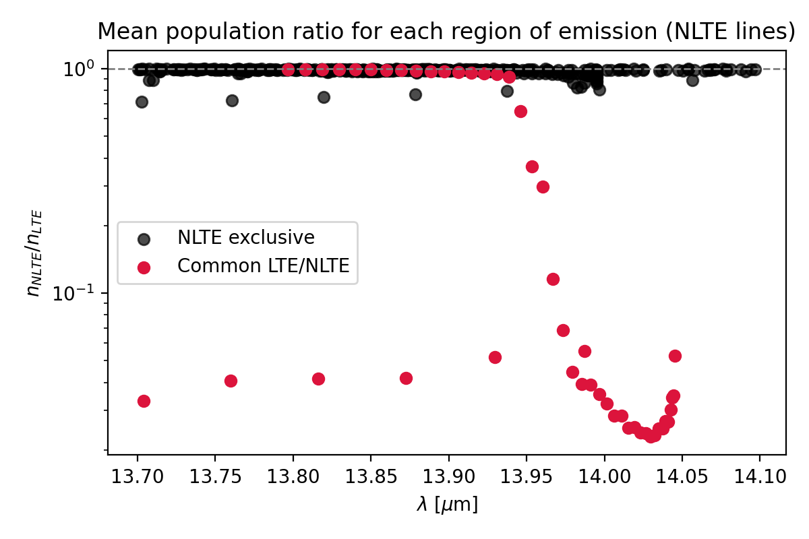
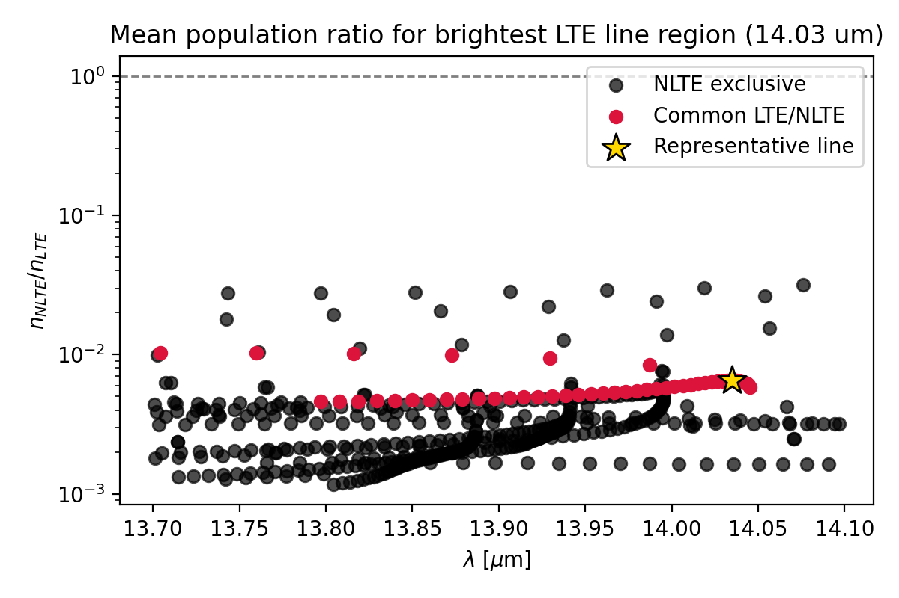

# HCN NLTE/LTE level populations in ProDiMo emission regions

Python analysis that measures how far the level populations of the HCN 14 µm
(ν₂ Q-branch) transitions depart from LTE **inside the disk region where each line is
actually emitted**, using the output of the thermo-chemical disk code
[ProDiMo](https://prodimo.iwf.oeaw.ac.at/) and the reader library
[prodimopy](https://gitlab.astro.rug.nl/prodimo/prodimopy).

For every line it computes the mean excitation ratio

$$
\frac{\left(N_u / N_l\right)_\mathrm{NLTE}}{\left(N_u / N_l\right)_\mathrm{LTE}},
\qquad
N_j = \sum_\mathrm{cells} x_j \, n_\mathrm{mol} \, V_\mathrm{cell},
$$

where $x_j$ is the fractional population of level $j$, $n_\mathrm{mol}$ the HCN number
density and $V_\mathrm{cell}$ the volume of each (annular) grid cell. A value of 1 means the
line is thermalised in its emitting region; values below 1 mean the upper level is
sub-thermally populated.

## Context

This code is my contribution, as co-author, to **[Frediani et al. (2026)](https://arxiv.org/abs/2609.08621)**,
where it was used to analyse NLTE effects on the HCN mid-infrared emission.

## Method

1. **Read the population files.** With `write_pop = .true.` ProDiMo writes, for a non-LTE
   model, `pop_PRO_<species>.out` (the NLTE populations actually used) and
   `pop_LTE_<species>.out` (the LTE populations at the same temperature and density), one row
   per cell with its borders `ra, rb, za, zb` (in m), the molecule density `nm` and the
   fractional population of each level ([`pop_ratios/io.py`](pop_ratios/io.py)).
2. **Map emission regions onto the pop files.** The emission region of a line is the
   prodimopy line-origin mask: radii between r15 and r85 of the cumulative line flux and,
   in each column, heights between z15 and z85. The pop files are written on a different
   grid (120×121) than the model grid, so the mask cannot be applied directly; instead a
   `scipy.spatial.cKDTree` built on the cell centres of the pop file is queried with the
   coordinates of the cells inside the mask ([`pop_ratios/masks.py`](pop_ratios/masks.py)).
3. **Compute the ratios** ([`pop_ratios/ratios.py`](pop_ratios/ratios.py)) in two ways:
   - `mean_population_emission_region`: every NLTE line in **its own** emission region
     (different lines probe different parts of the disk);
   - `mean_population_rep`: every NLTE line in **one fixed region**, the emission region of
     the brightest line of an independent LTE model. Because that LTE model comes from an
     older ProDiMo version, its grid is not in phase with the NLTE grid, so
     `ltemask_to_nonltemask` rebuilds the prodimopy mask algorithm and interpolates z15/z85
     onto the NLTE grid.

Lines present in both models are matched by wavelength and highlighted in the plots.

## Requirements and input data

```bash
pip install -r requirements.txt
```

Two ProDiMo model directories are needed (the model outputs are **not** included in this
repository: the HCN pop files alone are ~1.4 GB each):

| Model | Needed files | Relevant `Parameter.in` flags |
|---|---|---|
| NLTE | standard ProDiMo output (`ProDiMo.out`, `FlineEstimates.out`, …), `pop_LTE_HCN_H.out`, `pop_PRO_HCN_H.out` | `HCN_nonLTE = .true.`, `write_pop = .true.` |
| LTE | standard ProDiMo output incl. `FlineEstimates.out` | — |

## Usage

```bash
python run_analysis.py --nlte-model path/to/NLTE_model --lte-model path/to/LTE_model
```

Options: `--species` (default `HCN_H`), `--wl-min/--wl-max` in µm (default 13.7–14.1),
`--outdir` (default `output/`), `--no-show`. The script writes both figures as PDF and PNG and
a `mean_pop_ratios.csv` table with the values. The functions in `pop_ratios` can also be
imported directly from a notebook.

## Example output

NLTE/LTE ratio of each HCN line averaged over its own emission region:



The same ratio for all lines, averaged over the emission region of the brightest LTE line
(star):



## Limitations

- Lines are matched between models by wavelength, which is safe in the HCN Q branch (no
  two lines share a wavelength) but should be checked for other bands.
- The LTE→NLTE mask interpolation is only needed because the two models come from
  different ProDiMo versions; for models with the same grid the native prodimopy mask can be
  used directly.

## License

MIT — see [LICENSE](LICENSE).
